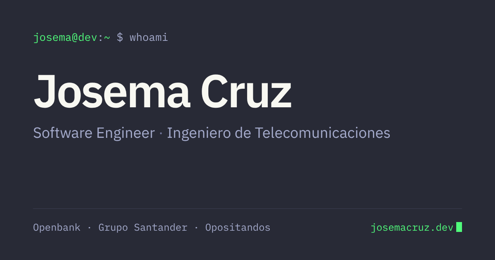

# **[Portfolio de Josema Cruz](https://josemacruz.dev)**



Portfolio personal con estética de terminal (tema Dracula), en español (`/`) e inglés (`/en`).

## Stack

- Next.js (App Router) + React + TypeScript
- CSS plano con variables (tema claro/oscuro según el sistema, con conmutador)
- Fuentes IBM Plex Sans y Mono vía `next/font`

## Desarrollo

```bash
bun install
bun run dev        # http://localhost:3000
bun run build      # build de producción
bun run typecheck
```

## Dónde editar el contenido

- `src/content/dictionaries.ts`: textos en español e inglés (intro, «Ahora», experiencia, side project, formación, idiomas). Actualiza `lastUpdated` al cambiar la sección «Ahora».
- `src/content/site.ts`: enlaces, empresas, fechas y tecnologías. Para mostrar el CV, sube `public/cv.pdf` y pon `cvPath: '/cv.pdf'`; para enlazar el TFG, rellena `thesisUrl`.

Las duraciones de cada puesto y los años de experiencia se calculan solos (la página se regenera cada día).
